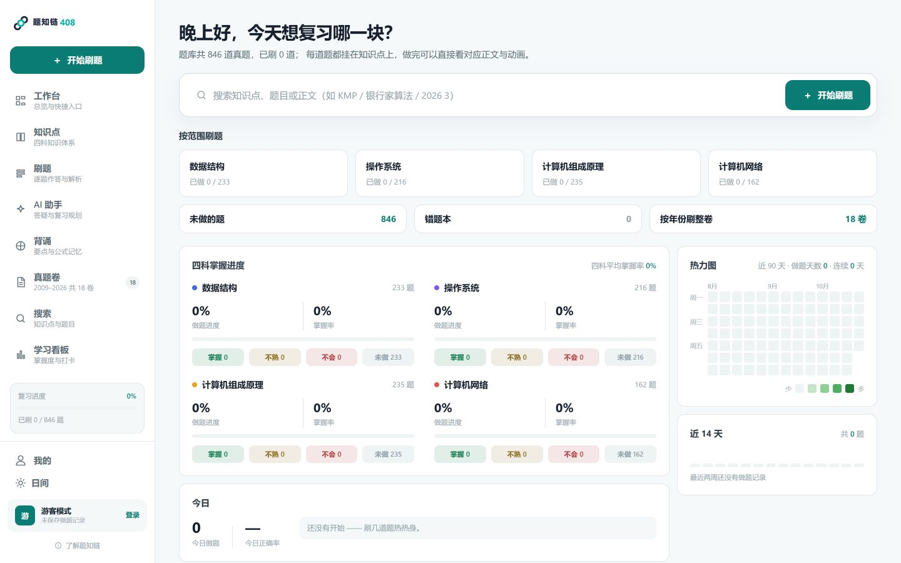
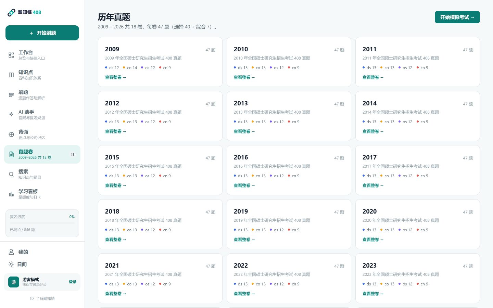

# 题知链 408 · 考研 408 备考平台

> 把 **846 道真题** 钉在 **147 个知识点** 上：刷题、看正文、查掌握度、问 AI，四件事共用一套知识索引。

[](https://github.com/ozzzzh/kaoyan408/actions/workflows/ci.yml)
[]()
[]()
[]()
[]()
[]()
[]()

## 界面预览

**工作台** —— 四科进度、掌握度、热力图与今日待办在同一屏。



**知识点正文** —— 侧栏知识点树 + 正文 + 本节真题入口 + 「问问 AI」。


**AI 学习助手** —— 回答末尾给出知识点卡片，点击直接跳到正文；也能从正文反向提问。


<details>
<summary>展开更多截图（刷题 / 真题卷 / 模拟考试 / 学习看板 / 落地页）</summary>

**AI 学习助手（空态）** —— 游客可试用 3 次，登录后能结合错题与掌握度。


**刷题** —— 逐题作答，交卷即出解析与关联知识块。


**真题卷** —— 2009–2026 共 18 卷，可按年份整卷查看。



**模拟考试** —— 整卷计时，选择题自动判分，综合题自评。


**学习看板** —— 按知识点掌握度排序，找出该补的章节。


**落地页** —— 站外介绍页，未登录可从 Logo 或「了解题知链」进入。


</details>

## 功能

| 模块 | 说明 |
| --- | --- |
| **刷题** | 846 道真题，按科目 / 年份 / 未做 / 错题筛选；作答即判分，附解析与关联知识块 |
| **知识点正文** | 147 个知识点、1634 个知识块；KaTeX 公式就地渲染，42 个知识块配 manim 动画 |
| **真题卷** | 18 卷（2009–2026），每卷 47 题（选择 40 + 综合 7） |
| **模拟考试** | 整卷限时作答，选择题自动判分（80 分），综合题对照参考答案自评（70 分） |
| **背诵** | 间隔重复（Leitner 8 盒，0/1/2/4/7/15/30/60 天） |
| **错题本** | 错题重做闭环，订正后标记掌握并移出队列 |
| **学习看板** | 四科掌握度、逐知识点正确率、90 天热力图 |
| **AI 学习助手** | 流式对话，注入用户掌握度与错题；回答带知识点跳转卡片 |
| **搜索** | 知识点 / 题目 / 正文全文检索 |

**免注册即可试做**：游客能完成刷题、模拟考试与 3 次 AI 对话，只是不保存记录。

## 技术栈

| 层 | 选型 |
| --- | --- |
| 前端 | Vue 3.5 + Vite 8 + TypeScript + Tailwind CSS 4 + Pinia + vue-router |
| 渲染 | KaTeX（公式）、marked + DOMPurify（正文）、manim-web（动画） |
| 后端 | Spring Boot 3.4 + Spring Security + MyBatis-Plus + Flyway |
| 存储 | MySQL 8（内容与做题数据） |
| AI | Command Code Provider API（OpenAI 兼容），SSE 流式 |
| 部署 | Docker Compose（nginx + api + mysql） |

## 持续集成

每次推送与 PR 触发 `.github/workflows/ci.yml`，三个 job 并行：

| job | 内容 | 依赖 |
| --- | --- | --- |
| 构建 | 前端 `vite build` + 后端 `mvn compile` | 无 |
| 数据库验证 | 建库 → 应用迁移 → 灌内容种子 → 跑内容完整性与动画覆盖回归 | MySQL 8 |
| 接口验证 | 启动后端（Flyway 自动迁移 + 自动灌种子）→ 跑搜索、错题、背诵、试卷、知识点关联回归 | MySQL 8 |

本地可执行的回归脚本清单见 `scripts/verify-*.mjs`，均支持环境变量配置：

```bash
DB_HOST / DB_PORT / DB_USER / DB_PASSWORD / DB_NAME   # 默认 127.0.0.1:3306 root/123456 kaoyan_db
API_BASE                                             # 默认 http://127.0.0.1:8080/api/v1
TEST_USERNAME / TEST_PASSWORD                        # 默认 tester01 / test123456
```

---

---

## 目录结构

```
408kaoyan/
├── client/                     # 前端
│   ├── public/exams/           # 18 卷 paper.json + 题目配图（静态资源）
│   └── src/
│       ├── api/                # 统一响应体封装与类型
│       ├── content/            # 知识树 knowledge-tree.ts（四科大纲）
│       │   └── knowledge-articles/   # 知识正文（按教材/章节分文件）
│       ├── animations/         # manim-web 动画模块（客户端渲染）
│       ├── store/ views/ router/ styles/
├── server/                     # 后端
│   └── src/main/
│       ├── java/com/kaoyan408/ # core / config / entity / mapper / service / controller
│       └── resources/
│           ├── application.yml
│           └── db/migration/   # V1 表结构，V2 内容种子（脚本生成）
├── scripts/
│   ├── content-bundle-entry.ts # 内容打包入口（TS → ESM）
│   └── import-content.mjs      # 校验 + 生成种子 SQL +（可选）入库
├── web/nginx.conf              # 静态资源 + /api 反向代理
└── docker-compose.yml
```

## 本地开发（原生 MySQL）

前置：JDK 17、Maven 3.9+、Node 18+、本地 MySQL 8（默认 3306）。

```bash
# 1) 建库（只需一次）
mysql -u root -p -e "CREATE DATABASE IF NOT EXISTS kaoyan_db CHARACTER SET utf8mb4;"

# 2) 安装依赖
npm install                 # 根：esbuild + mysql2（内容导入用）
npm --prefix client install # 前端

# 3) 生成内容种子并写入数据库（V2__seed_content.sql 已随仓库提供，可跳过生成）
npm run import:content      # 仅生成 SQL 并打印校验报告
npm run import:apply        # 生成并直接灌入本地库（默认 127.0.0.1:3306）

# 4) 启动后端（Flyway 会自动建表并灌入种子）
cd server
DB_PASSWORD=你的密码 mvn spring-boot:run
# Windows PowerShell: $env:DB_PASSWORD="你的密码"; mvn spring-boot:run

# 5) 启动前端（默认 5173，/api 已代理到 8080）
npm run dev
```

浏览器打开 <http://127.0.0.1:5173>。

> IDEA 用户：直接以 Maven 项目打开 `server/`，运行 `KaoyanApplication`；
> 在 Database 工具里连 `127.0.0.1:3306/kaoyan_db` 即可查看表数据。

### 端口约定

| 用途 | 端口 |
| --- | --- |
| 前端 dev server | 5173 |
| 后端 API（本地） | 8080 |
| nginx（容器部署） | 18080（`WEB_PORT` 可覆盖） |
| MySQL（容器，映射到宿主） | 33061（`DB_PORT` 可覆盖） |

## Docker 部署

```bash
cp .env.example .env            # 修改 DB_PASSWORD 与 JWT_SECRET
npm --prefix client install
npm --prefix client run build   # 产出 client/dist，由 nginx 挂载
docker compose up -d --build
```

访问 <http://服务器地址:18080>（默认端口 18080，避开本机开发常用的 8080）。

首次启动 api 容器时，Flyway 应用表结构迁移（V1 表结构、V2 错题重做字段），
随后 `ContentSeedConfig` 在题库为空时灌入内容种子（约 3MB，实测耗时约 23 秒）。

### 部署实测结论（本机验证过一次完整流程）

以下三点是实际部署时踩到或需要预先知道的，不是推测：

1. **nginx 配置必须覆盖 `default.conf`，不能并排新增。**
   官方 nginx 镜像自带 `/etc/nginx/conf.d/default.conf`，同样声明
   `listen 80; server_name _;`。两个 server 块条件完全相同时 nginx 只采用
   **先加载**的那个（按文件名排序，`default.conf` 在前），
   结果是 `location /api/` 反代规则被整体绕过，`/api/v1/health` 被当作静态文件
   返回 404。compose 中因此挂载到 `default.conf` 而非 `kaoyan.conf`。

2. **内容种子不在 Flyway 版本链中。**
   种子由 `scripts/import-content.mjs` 生成到 `server/src/main/resources/seed/content.sql`，
   运行时由 `ContentSeedConfig` 加载（题库非空则跳过；
   `kaoyan.seed.force=true` 可强制重灌）。
   内容属于数据而非表结构，若作为迁移会因频繁重生成导致 checksum 漂移、应用无法启动。

3. **无外网时需自备基础镜像。**
   若环境无法访问 `registry-1.docker.io`（DNS 解析失败），可用镜像站拉取后重新打标签：

   ```bash
   docker pull docker.m.daocloud.io/library/eclipse-temurin:17-jre
   docker tag  docker.m.daocloud.io/library/eclipse-temurin:17-jre eclipse-temurin:17-jre
   docker pull docker.m.daocloud.io/library/nginx:1.27-alpine
   docker tag  docker.m.daocloud.io/library/nginx:1.27-alpine nginx:1.27-alpine
   ```

   构建阶段与数据库使用的 `maven:3.9.10-eclipse-temurin-17`、`mysql:8.0`
   通常已在本机镜像缓存中。

### 常用运维命令

```bash
docker compose -p kaoyan408 ps                    # 查看状态
docker compose -p kaoyan408 logs -f api           # 跟踪后端日志
docker compose -p kaoyan408 up -d --build api     # 只重建后端
docker compose -p kaoyan408 down                  # 停止（不加 -v，保留数据卷）
```

改过 `web/nginx.conf` 后必须重建 web 容器（挂载为只读文件，不会自动重载），
并确认经 nginx 的 `/api` 链路仍然可用：

```bash
curl -sS -o /dev/null -w '%{http_code}\n' http://127.0.0.1:18080/api/v1/health
```

### 修改已应用的迁移会导致服务无法启动

Flyway 对每个已应用的迁移记录 checksum，**文件内容任何改动都会使其失配**，
包括只改注释、改空行。此时启动直接失败：

```
Migration checksum mismatch for migration version N
-> Applied to database : ...
-> Resolved locally    : ...
```

本项目在 V1、V4、V5 上各踩到一次（都只是改了注释）。规则：

- **已应用（已入库）的迁移一律视为不可变**，需要调整就追加新迁移。
  例如删除某次迁移里多加的索引，正确做法是新增一个 `DROP INDEX` 迁移，
  而不是回头删掉那一行。
- 若确认**只改了注释或空白、DDL 完全没变**，可用 repair 对齐 checksum：

  ```bash
  cd server
  FLYWAY_URL='jdbc:mysql://127.0.0.1:3306/kaoyan_db?characterEncoding=UTF-8&useUnicode=true&allowPublicKeyRetrieval=true' \
  FLYWAY_USER=root FLYWAY_PASSWORD='<密码>' \
  mvn -B flyway:repair
  ```

  容器环境同理，把 URL 换成容器内可达的地址即可。
- **DDL 有实质变化时禁止用 repair 蒙混**：repair 只改记录、不动表结构，
  会让数据库与迁移文件长期不一致。这种情况必须新增迁移来纠正。
- 迁移失败会在 `flyway_schema_history` 留下 `success=0` 的记录，需先删除该行
  （确认表结构未被部分改动）后再重试。

## 运维与升级要点（2026-11 加固）

这一节记录本轮加固后**会改变运维动作**的地方。改动本身在 git 历史里，这里只写「你需要知道什么」。

### JWT 密钥校验与应急开关

密钥等于仓库公开默认值、或短于 32 字节时，服务**默认拒绝启动**：公开密钥意味着任何人都能
签出任意账号的 token，这时候站点「能用」比「停掉」更危险。

但配置错误导致的停站也是事故，所以留了一个显式应急通道：

```bash
KAOYAN_AUTH_ALLOW_INSECURE_JWT_SECRET=true docker compose -p kaoyan408 up -d api
```

打开后改为告警并照常启动（过短密钥会做 SHA-256 派生以满足 HS256 的长度要求，熵不变、仍是弱密钥）。
它是**临时恢复手段**：起来后请立刻换掉密钥并关掉开关。

### 升级后所有用户需要重新登录一次

JWT 现在带 `ver` claim，与 `app_user.token_version` 比对。升级前签发的 token 没有该字段，
会被判为失效 —— 这是一次性代价，换来的是「禁用账号 / 改密码 / 踢下线」能立即生效
（把 `token_version` 加一即可，60 秒内生效）。

### 背题模式需要登录

`GET /api/v1/questions/{ref}?memorize=true` 现在未登录返回 401。之前它对匿名开放，
等于把 846 道真题的答案做成公开接口，模拟考「考试中不下发答案」的约束被一个参数绕过。
普通做题路径不变：游客照样能作答、判分、看解析，只是不落库。

`reveal` 参数已移除（原条件 `answered && (reveal == 0 || reveal == 1)` 恒为真，从未生效）。

### 内容更新的正确流程

```bash
npm run import:content                          # 改完 client 侧 TS 内容后重新生成 seed
docker compose -p kaoyan408 up -d --build api   # 重启后按种子指纹自动判断是否重灌
```

种子加载现在有四个保护：事务、`GET_LOCK` 互斥、SHA-256 指纹、用户数据守卫。

- **指纹一致** → 跳过（不再每次启动写 3MB）。
- **指纹变化且无作答数据** → 自动重灌（实测 7 秒左右）。
- **指纹变化但已有作答数据** → **拒绝重灌**并打印指引。因为重灌会 DELETE 题库、
  `question.id` 重新自增，历史作答会变成孤儿记录。确认要丢弃历史时才设置：
  `KAOYAN_SEED_FORCE=true`（强制重灌）+ `KAOYAN_SEED_FORCE_WITH_USER_DATA=true`（确认丢弃历史）。
- 首次部署（题库为空）不需要任何开关。

### 后端取值前提：api 端口不要对外映射

限流用的客户端 IP 来自 nginx **无条件覆盖**写的 `X-Real-IP`（`X-Forwarded-For` 可被请求头伪造，
已不再采信）。这个前提成立的条件是 api 容器只有 `expose`、所有流量经 nginx。
若为了本地开发把 `ports: - "8080:8080"` 加到 api 上，直连流量可以伪造 `X-Real-IP`，
届时必须改成「按受信代理网段取 XFF 最后一跳」。

### 传输与安全头

- nginx 已开 gzip：`/practice/queue` 从 197KB 降到 8.8KB（4.4%），知识树 13KB→3.3KB。
- 下发 CSP、`X-Content-Type-Options`、`X-Frame-Options`、`Referrer-Policy`、`Permissions-Policy`。
  这些头在 `web/snippets/security-headers.conf`，**每个带 `add_header` 的 location 都要 include**：
  nginx 的 `add_header` 是就近覆盖语义，只写在 server 级会被那些 location 静默丢掉。
- 首帧主题预设在 `client/public/theme-init.js`，在 `<head>` 里同步加载（否则暗色用户先闪白）。
  它是外链而不是内联脚本，就是为了让 CSP 保持 `script-src 'self'`。
- HSTS 没有在源站下发：线上入口是网关终止 TLS，写死在源站会在用 `IP:端口` 直连时把用户锁死。

### 测试与门禁

```bash
npm --prefix client run typecheck   # vue-tsc；build 已内置这一步，类型错不再能进构建
npm --prefix client test            # 渲染安全不变式（12 个用例，vitest + jsdom）
cd server && mvn -B test            # 接口契约测试（10 个用例）+ jacoco 行覆盖门限
```

- 后端测试需要可用的 MySQL：`DB_URL / DB_USER / DB_PASSWORD` 环境变量；
  Flyway 自动迁移，题库已存在时不重复灌种子。
- jacoco 门限是 0.10（实测约 21%），它是护栏不是目标：防止覆盖率继续往下掉。
- CI 已接入这两步（build job 跑前端单测，api job 在 MySQL 就绪后跑后端契约测试）。

### 生产机构建前端的前提（重要）

生产机（10.0.219.241）当前是 **Node v20.11.1**，而本项目依赖 **vite 8.3.5**，
它要求 Node `^20.19.0 || >=22.12.0`。实测在该机上直接 `npx vite build` 会报：

```
SyntaxError: The requested module 'node:util' does not provide an export named 'styleText'
```

所以**不能直接用系统 node 在服务器上构建前端**。日常流程是本地构建后上传，已封成一条命令
（见下面「一键发版」）。

要把构建能力还给服务器，需要 Node 22 LTS（或 20.19+）。已经装在 `/opt/node22`
（不动系统 node，避免影响同机其它项目），用法见「服务器上的 Node 22」。

### 让回访更快：Cloudflare 缓存规则（面板操作，不在仓库里）

现状：nginx 已经对入口 HTML 下发 `public, max-age=0, s-maxage=60, stale-while-revalidate=300`，
但 **Cloudflare 默认不缓存 HTML**——实测两次请求都是 `cf-cache-status: DYNAMIC`，
意味着每次访问都要跨境回源一次（实测 TTFB 中位 1.5s）。

在 Cloudflare 面板里加一条 Cache Rule 即可（一次性操作）：

> 注意 zone 名：本站域名本身就是 zone 的 apex，所以 zone 是 **`tizhilian408.de5.net`**，
> 不是 `de5.net`（按 `de5.net` 查会查不到）。

| 项 | 值 |
| --- | --- |
| 规则名 | `cache-html-60s` |
| 匹配条件 | 表达式填 `(http.request.uri.path eq "/") or (http.request.uri.path eq "/index.html")` |
| Cache eligibility | Eligible for cache |
| Edge TTL | Override origin → **60 seconds** |
| Browser TTL | Respect origin（浏览器端仍 `max-age=0`，不会拿到旧入口） |

验证：`curl -sI https://<域名>/ | grep -i cf-cache-status`，期望 `HIT`。

注意：发版后最多 60 秒全量生效（资源都是带哈希的 chunk，不会出现「入口旧、chunk 新」的白屏）；
需要立刻生效就在 Cloudflare 后台 Purge 一次。

顺带确认 Brotli 已开（Speed → Optimization → Brotli：On）：实测队列接口 `br` 后 991 字节。

### 前端性能结构（改动后长这样）

- **首屏不再加载 marked / KaTeX**：`utils/` 拆成 `htmlEscape`（无依赖）、`htmlSanitize`（DOMPurify）、
  `htmlMath`（KaTeX）、`html`（marked 编排）与 `stem`（题干轻量渲染）。
  刷题页只依赖 `stem` + `htmlEscape`；题干里真的出现 `$...$` 时才动态 `import('@/utils/htmlMath')`。
  改前刷题页会拉一个 328KB 的 chunk（marked + DOMPurify + KaTeX），现在首屏只有 30KB 的视图代码。
- **Service Worker**（`public/sw.js`）：`/assets/**` cache-first（文件名带哈希，不可变）、
  导航 network-first（3 秒超时回退缓存）、其它静态资源 SWR；`/api/**` 完全不缓存。
  只在生产构建注册。改名 `CACHE` 常量即可整体失效。
- **队列内联首题**：`/practice/queue` 在首页且非错题范围时会带 `firstQuestion`，
  刷题首屏因此只有 2 个请求（`stats/dash` + `queue`），不再单独打 `/questions/{ref}`。
- **知识点图片外置**：正文里内联的图片（含内联 SVG）改由
  `/api/v1/knowledge/asset/{blockId}?v=<指纹>` 提供，长缓存 + CSP `sandbox`。
  最重的一篇正文从 357KB 降到 23KB（gzip 6KB）。

### 一键发版（`npm run deploy`）

手动发版容易漏步骤（尤其 `--force-recreate web`：bind mount 持有旧 inode，不强制重建页面就还是旧的）。
现在封成一条命令：

```bash
npm run deploy          # 本地构建 → 上传 dist → 切换 → 重建 web → 健康检查
npm run deploy:api      # 顺带重建后端镜像（改了 Java / 新增迁移时）
```

前置：本机装了 Python 3 + `paramiko`（`pip install paramiko`），并且
`~/.ssh/config_metadata.json` 里有 `ipeagent-server` 的连接信息
（也可用 `DEPLOY_HOST / DEPLOY_PORT / DEPLOY_USER / DEPLOY_PASSWORD` 覆盖；
脚本优先取 `~/.ssh/config` 里的端口——metadata 里那个端口曾经是过期的 22，照它连会认证失败）。

脚本做的事：`npm run build`（含类型检查）→ 打包 `client/dist` → SFTP 上传 →
服务器上解包到 `dist.new`、旧 `dist` 改名 `dist.prev.<时间戳>`（保留最近两版用于回滚）→
`up -d --force-recreate web` → 探 `/api/v1/health` 与公网首页。

改完后端要一起发时用 `--api`：它会重建 api 镜像并执行 Flyway 迁移。
若服务器代码还没同步，可以带 `--patch <补丁文件>`：脚本会先 `git apply` 并提交到服务器仓库。

### 服务器上的 Node 22（恢复服务器侧构建）

生产机系统 Node 是 v20.11.1，而 vite 8 要求 `^20.19 || >=22.12`，直接在服务器
`vite build` 会报 `node:util does not provide an export named 'styleText'`。

已把 Node 22 独立装在 **/opt/node22**（不动系统 `/usr/local/bin/node`，避免影响同机其它项目）：

```bash
cd /mnt/workspace/kaoyan408/client
export PATH=/opt/node22/bin:$PATH
npm run build      # 依赖已装好，现在可以直接在服务器构建
```

日常发版仍推荐本地构建（`npm run deploy`）；服务器侧构建作为应急手段保留。

### 已完成：入口 HTML 已被边缘缓存

2026-11-16 用 `npm run cf:cache-rule` 在 zone `tizhilian408.de5.net` 上创建了
`cache-html-60s (kaoyan408 entry)` 规则（`/` 与 `/index.html`，Edge TTL 60s，Browser TTL 跟随源站）。
实测 `npm run check:edge`：

```
第1次 838ms MISS（回源并填充边缘） → 第2、3次 245ms / 248ms HIT
对比：一次未缓存的 /api/v1/health 往返 1654ms
```

也就是说入口 HTML 的往返从「每次 1.6 秒」降到「边缘 0.25 秒」。发版后最多 60 秒生效
（SWR 让过期后的第一个访客也不阻塞）；要立刻生效就在 Cloudflare 后台 Purge 一次。

**下一个可选优化**：`/api/v1/knowledge/**` 与 `/api/v1/exams/**` 是匿名且与用户无关的内容接口，
nginx 已经给了 `max-age=300`，但 Cloudflare 默认不缓存 JSON。再加一条针对这两个前缀的
Cache Rule（Edge TTL 300s）就能把阅读页/真题页的往返也压到 0.25 秒级；
`/practice/queue` 这类带用户进度的接口不能缓存，保持现状。
### 用 API 建 Cache Rule（`npm run cf:cache-rule`）

不想点面板就用脚本，效果一样：

```bash
# 1. Cloudflare → My Profile → API Tokens → Create Token（自定义）
#    权限：Zone → Cache Rules → Edit、Zone → Zone → Read（想自动清缓存再加 Cache Purge → Purge）
#    Zone Resources 限定到 tizhilian408.de5.net，不要给 All zones
# 2. 本机设置（只在本机，不进仓库）
setx CF_API_TOKEN "<token>"          # Windows；之后新开的终端生效
# 3. 执行（会先查 zone、合并已有规则、清理入口缓存，再验证）
npm run cf:cache-rule
npm run cf:cache-rule -- --dry-run   # 只看将要提交的规则
npm run check:edge                   # 单独再验一次，期望 cf-cache-status: HIT
```

用完后建议在 Cloudflare 后台把该 Token 撤销（它是长期凭据，只这次用得上）。
### 边缘缓存自检（`npm run check:edge`）

```bash
npm run check:edge                        # 默认查 tizhilian408.de5.net
npm run check:edge -- https://其他域名
```

连续取三次首页，打印 `cf-cache-status` / `cache-control` / 编码 / 耗时，并给出结论。
当前应当是 `DYNAMIC`（说明 Cloudflare 的 Cache Rule 还没加），加上之后会变成 `HIT`。
### 演示账号与管理员

**演示账号**（公开可登录，用于让访客直接看到"有数据的样子"）：

- 默认 `demo / demo123456`，可通过 `KAOYAN_DEMO_USERNAME` / `KAOYAN_DEMO_PASSWORD` 覆盖；
  `KAOYAN_DEMO_ENABLED=false` 可完全关闭。
- 首次创建时会预置一点历史数据（18 条作答、3 天打卡、6 张背诵卡），
  这样工作台、热力图、错题本都不是空的。只在"该账号完全没有作答记录"时执行，
  重启不会越积越多。
- 登录页会显示这张卡片并支持"一键填入"，密码来自 `GET /api/v1/auth/demo-info`
  （匿名可读）—— 这样运维改了口令，登录页不会继续显示旧密码。
  接口只回显这一个公开账号，管理员密码永远不经过任何接口取回。

**演示账号（含管理员视图，2026-11-18 起合并为一个入口）**

登录页现在只给一个演示入口：`demo` / `demo123456`。它同时具备：

- **完整学习数据**：220 条作答（约 28% 错题）、56 道错题、14 天连续打卡、4 次模拟考试、72 张背诵卡；
- **后台只读视图**：可以看站点概览与账号列表，但所有写操作在服务端被拒（403）。

原来独立的 `demo-admin` 已停用（`KAOYAN_DEMO_ADMIN_ENABLED=false` 为默认值），
它在首次启动时会被自动禁用。这样演示时不必在"普通用户视角"和"管理员视角"之间切换账号。

**（历史）独立演示管理员**：

- 默认 `demo-admin / demo-admin123456`，`KAOYAN_DEMO_ADMIN_*` 可覆盖。
- **默认只读**：能看站点概览与账号列表，所有写操作在服务端被拒（403）。
  公开站点上一个能点按钮的完整管理员，等于把「禁用所有账号 / 清空所有数据」
  做成任何人都能点的功能，所以默认收口；确需可操作时设
  `KAOYAN_DEMO_ADMIN_READONLY=false`。
- 它与真管理员**必须是两个账号**：用户名相同会导致启动时跳过并报错，
  避免把真管理员变成公开账号。

登录页会列出这两个入口（`GET /api/v1/auth/demo-info` 匿名返回），点一下直接登录。

**管理员账号**：

```bash
# 首次部署时在 .env 里设置，密码只从这里来（仓库里没有默认管理员口令）
KAOYAN_ADMIN_USERNAME=admin
KAOYAN_ADMIN_PASSWORD=<你的强密码>
# 忘记密码时置 true 重启一次即可重置（会顺手踢掉旧登录态）
KAOYAN_ADMIN_RESET_PASSWORD=false
```

启动时会自动创建或对齐该账号（设为管理员、恢复启用）。用户名留空则什么都不做。

管理员入口：工作台左侧「管理」（仅管理员可见），页面在 `/#/admin`，提供：

| 能力 | 说明 |
| --- | --- |
| 站点概览 | 账号数/启用数/管理员数、近 7 天新增、累计与今日作答、题库规模、背诵卡片、模拟考、AI 对话 |
| 账号列表 | 分页 + 按用户名/邮箱搜索，显示作答数、卡片数、最近活跃 |
| 禁用/启用 | 禁用会立刻踢掉该用户的登录态 |
| 授予/撤销管理员 | 权限位走缓存（60 秒内生效，操作时主动失效） |
| 重置密码 | 不填则生成 10 位随机密码并在响应里回显一次，同时让旧登录态失效 |
| 清空练习数据 | 只删作答/掌握度/打卡/背诵/模拟考记录，不删账号 |

三条安全约束：不能禁用或降权自己；不能撤销最后一个管理员；禁用/改密必然使旧 token 失效。
权限实现在服务端（`/api/v1/admin/**` 要求 `ROLE_ADMIN`），前端隐藏入口只是体验层面。

### 账号资料与安全（2026-11 新增）

「我的」页拆成 3 块：**个人头部 / 账号与资料 / 安全**，下面是原有的学习概况与足迹。

| 能力 | 说明 |
| --- | --- |
| 昵称 | `app_user.display_name`，2–20 字；**username 只读**（它是 JWT subject、限流键与越权校验的依据，改名牵连太广） |
| 头像 | 只存标识不存图片：`auto`（按用户名哈希生成首字母+配色）或 `emoji:🦊`（服务端白名单校验）。不需要对象存储与上传接口 |
| 修改密码 | 当前密码 + 新密码（≥8 位、非纯数字、不能与旧密码相同）+ **邮箱验证码**；成功后 `token_version+1`，**其它设备全部掉线**，响应返回新 token 让当前会话无缝续用 |

**验证码按用途隔离**：`verify_code` 新增 `purpose`（`register` / `reset-password`），
唯一键从 `(channel,target)` 扩成 `(channel,target,purpose)`，校验时必须带同样的用途——
否则注册拿到的码可以直接用于改密码。`send-mail-code?purpose=reset-password` 还会强制：

- 必须已登录；
- 只用**当前账号自己的邮箱**（忽略请求体里的 email），否则这个接口等于给任意地址发信；
- 演示账号直接拒绝。

**演示账号（demo / demo-admin）的两条锁定**：资料不可改、密码不可改，页面会明确说明原因
（公开展示账号，改了所有人登不进去），服务端同样返回 403 —— 前端禁用只是提示。

### 已知取舍

- **刷题队列没有改成翻页**：接口已支持 `page/size` 并返回真实 `total` 与年份分组（`years`），
  但前端仍一次取全量。理由是 gzip 已把该响应压到 8.8KB，而翻页会破坏
  「搜索直达单题后还能在同年份继续上一题/下一题」的交互，收益递减。
- **CSP 放行 `style-src 'unsafe-inline'`**：KaTeX 与 Tailwind 任意值类会产生内联 style 属性，
  收紧会导致公式错版。脚本侧仍是严格 `script-src 'self'`。

---
## 接口约定

所有接口返回 **HTTP 200** + 统一响应体，业务语义由 `code` 表达：

```json
{ "code": 0, "msg": null, "data": {} }
```

| code | 含义 |
| --- | --- |
| 0 | 成功 |
| 400 | 参数校验失败 |
| 401 | 未登录 / 登录失效（`认证失败，无法访问系统资源。`） |
| 404 | 端点或资源不存在（`No endpoint GET /xxx.` 与 408os 一致） |
| 429 | 触发限流（登录失败锁定 / 验证码发送过频 / 游客试用次数用完） |
| 500 | 服务端异常 |
| 503 | 依赖服务未配置（如 AI 未配置 API Key） |

鉴权：`Authorization: Bearer <token>`（HS256 JWT）。

绝大部分接口返回上述统一 JSON；**唯一例外是 AI 对话** `POST /api/v1/ai/chat`，
它以 `text/event-stream` 流式返回，事件类型为 `thinking` / `delta` / `done` / `error`。

主要端点：

| 方法 | 路径 | 说明 |
| --- | --- | --- |
| GET | `/api/v1/health` | 健康检查 |
| POST | `/api/v1/auth/login` · `/auth/register` | 登录 / 注册 |
| GET | `/api/v1/user/current` | 当前用户 |
| GET | `/api/v1/exams` · `/exams/{year}` | 试卷列表 / 整卷 |
| GET | `/api/v1/questions/{examRef}` | 单题（未作答不下发答案与解析） |
| POST | `/api/v1/questions/{examRef}/answer` | 提交答案 |
| GET | `/api/v1/knowledge` · `/knowledge/point/{pointId}` · `/knowledge/block/{blockId}` | 知识树 / 知识点正文 / 知识块与关联真题 |
| GET | `/api/v1/search` · `/search/suggest` | 全文搜索（知识点 / 题目 / 正文片段）与输入联想 |
| GET | `/api/v1/practice/queue` | 刷题队列（scope：all / wrong / untouched / wrong-pending / wrong-mastered） |
| GET | `/api/v1/practice/wrong-book` · `/practice/entrances` | 错题本（待订正 / 已订正）、刷题入口汇总 |
| GET | `/api/v1/stats/dash` · `/stats/points` | 学习看板、知识点级掌握与薄弱点 |
| GET · POST | `/api/v1/memory/due` · `/summary` · `/review` · `/add` · `/remove` | 背诵卡片与间隔重复（需登录） |

## 内容数据来源与许可

- 真题与知识正文来源于 [simple408](https://github.com/liangbohan/postgraduate-exam-website)（**CC BY 4.0**）。
- 真题题面、选项、答案与解析以 **408os** 为官方参照进行校准。
- 本仓库对这些内容进行结构化二次组织（拆分为题库与知识块并建立关联），供复习用途使用。
- 详见 [LICENSE](./LICENSE)。

## 里程碑

| 阶段 | 内容 | 状态 |
| --- | --- | --- |
| M0 | 仓库骨架、表结构、内容入库（846 题 / 1634 知识块 / 1030 条关联）、认证与看板接口 | ✅ 完成 |
| M1 | 知识阅读页（KaTeX 公式 + 42 个 manim 动画）、全文搜索、刷题队列、错题重做闭环、真题卷整卷阅读 | ✅ 完成 |
| M2 | 学习看板深化（知识点级薄弱点）、间隔重复背诵卡片 | ✅ 完成 |
| — | Docker 部署实测跑通（含 nginx 反代与迁移流程） | ✅ 完成 |
| M3 | 整卷限时模拟考试（答题卡 / 自动评分 / 成绩单 / 综合题自评） | ✅ 完成 |
| M4 | 账号体系（邮箱验证码注册 / 登录锁定 / 禁用账号）、游客模式 | ✅ 完成 |
| M5 | AI 学习助手（流式对话 / 注入学习数据 / 知识点跳转）、营销落地页 | ✅ 完成 |
| 待定 | 自定义域名与 HTTPS、CC BY 署名策略复核 | 未开始 |

规划全文见 [`docs/考研408工作台规划书.md`](./docs/考研408工作台规划书.md)。